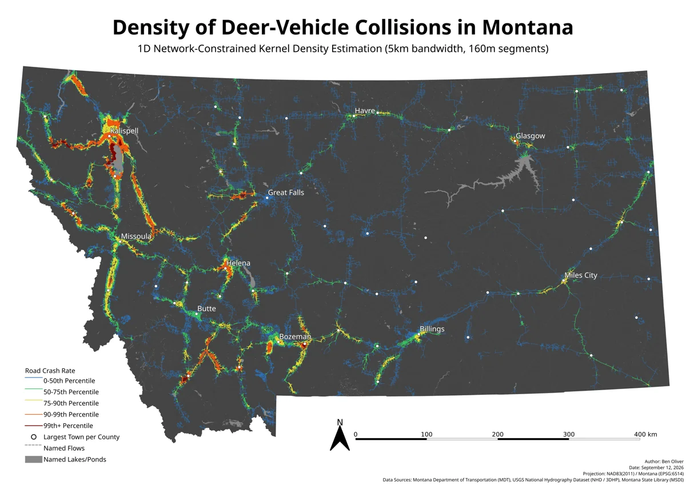
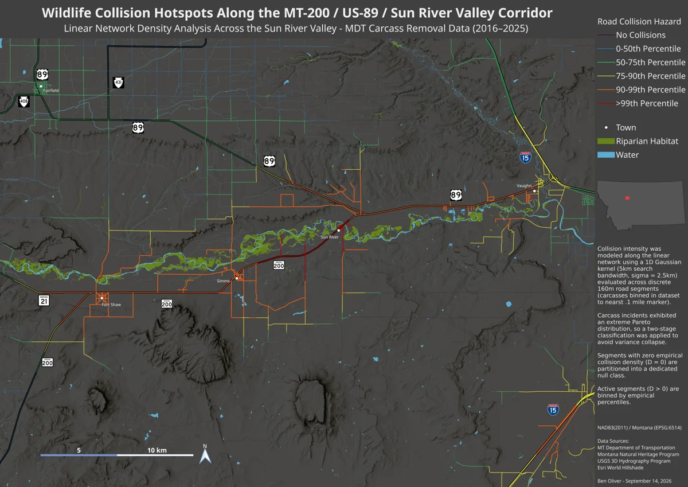
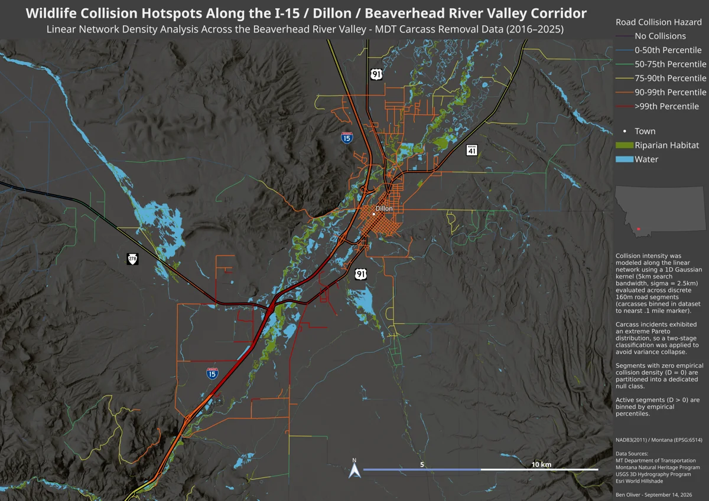
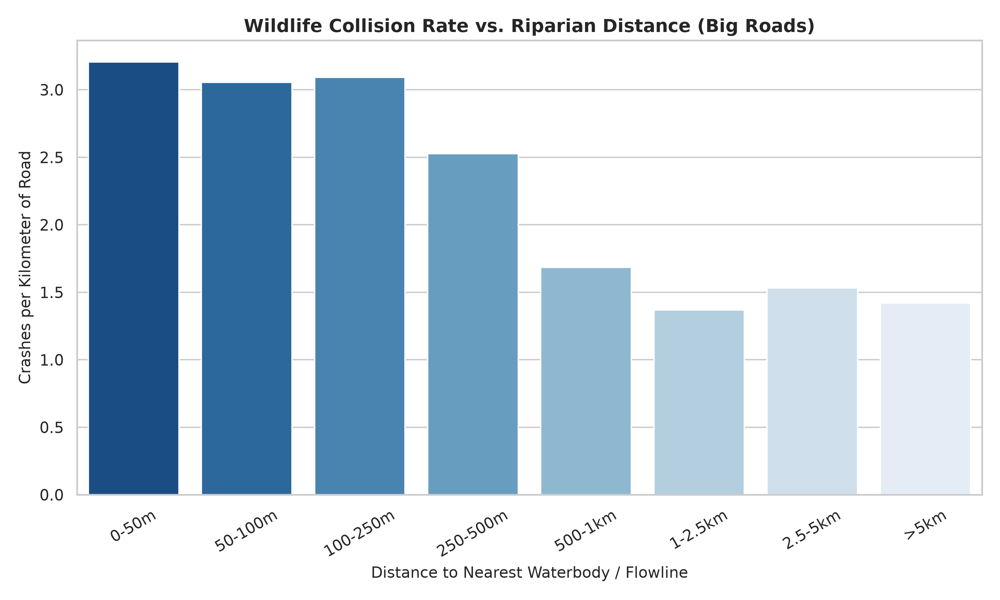
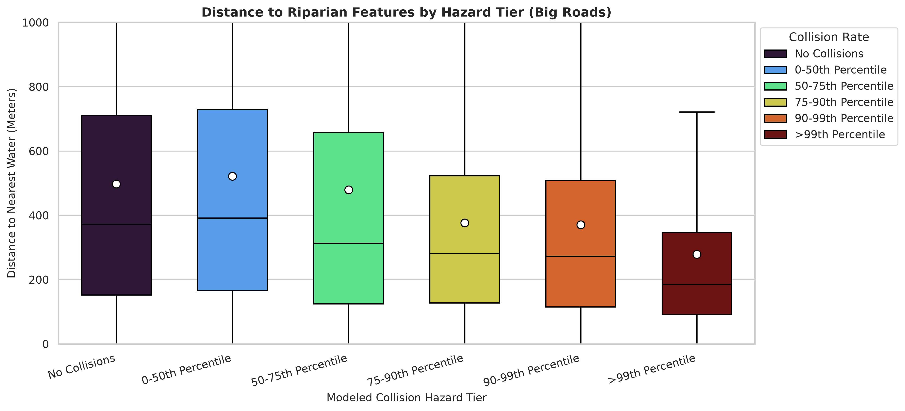
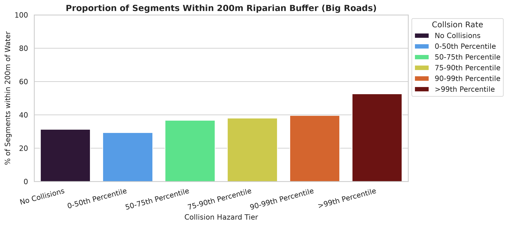

# Deer-vehicle collisions and river corridors in Montana

Where on Montana's roads do drivers hit deer most often, and how much of that comes down to roads running close to rivers and streams?

I took Montana Department of Transportation carcass-removal records from 2016 to 2025, estimated collision density along every road in the state, and compared the worst stretches with their distance to perennial water and riparian habitat.

**Browse the maps at full resolution:** https://benolivr.github.io/montana-deer-collisions/

## Question

How much do year-round rivers and streams drive deer-collision hotspots on Montana roads, and does the pattern get stronger on bigger, busier roads?

My hypothesis was that collision rates fall steadily with distance from perennial water, peak where roads run within about 250 m of it or cross riparian habitat, and that the effect is stronger on highways than on local roads.

## Maps

All three maps were made in QGIS and exported at about 14,000 × 9,900 px. Click a preview to download the full-resolution image.

| | |
|---|---|
|  | **Statewide.** Collisions concentrate in the western river valleys, where mountains squeeze highways, riparian habitat and deer into the same narrow corridors: the Flathead and Bitterroot (US-93), and the Gallatin and Upper Yellowstone (I-90 / US-191). East of the divide, risk rises mainly where highways follow big rivers, like US-2 along the Milk and I-94 along the Yellowstone. |
|  | **Sun River Valley (MT-200 / US-89).** Few people live here, so traffic is light even for a highway, yet the stretch between Fort Shaw and Vaughn is in the top 1% statewide. Risk drops to moderate where MT-200 swings away from the river near Simms, and peaks where it runs beside and across the riparian canopy. |
|  | **Dillon and the Beaverhead River (I-15).** A divided, four-lane interstate, and still in the top 1% where it crosses and parallels the Beaverhead's riparian corridor. The highest-risk segments line up with the riparian habitat here too. |

## Results

| | |
|---|---|
|  | On primary and secondary roads (122,643 segments), collision rates are highest within 250 m of perennial water, at about 3.1–3.2 carcasses per km, and fall to roughly 1.4 per km beyond 1 km. Across all roads the same shape holds at a much lower level: 0.42 per km at 50–100 m from water, 0.06 per km beyond 2.5 km. |
|  | The higher a highway segment's hazard tier, the closer it tends to sit to water. The median distance falls to about 190 m for the top 1% of segments. |
|  | About 30% of highway segments with no recorded collisions are within 200 m of water. For the top 1% it's over 50%. |

The all-roads versions of these charts are in [`figures/`](figures/). Filtering to highways strips out a lot of noise from low-traffic local roads, and the relationship with water gets much clearer.

## Method

1. **Carcasses.** Filtered the MDT records to white-tailed and mule deer, dropped rows flagged as invalid coordinates, and clipped to the state boundary. The records are binned to the nearest 0.1-mile marker rather than exact positions.
2. **Road segments.** Cut every road in the Montana Transportation Framework into 160 m pieces (about 0.1 mile, to match the carcass binning), about 1.25 million in all, and snapped each carcass to the nearest segment within 500 m.
3. **Density.** For each segment, summed a Gaussian kernel (σ = 2.5 km) over every carcass-bearing segment within 5 km, using a KD-tree for the neighbor search. Distances are straight-line, not along the road network (see below).
4. **Classification.** Collision counts are extremely skewed, so segments with zero density get their own class and the rest are binned by percentile: 0–50th, 50–75th, 75–90th, 90–99th, and above the 99th.
5. **Water proximity.** Measured each segment's distance to the nearest perennial flowline (USGS 3DHP) or perennial waterbody (NHD), and compared hazard tiers on all roads and on primary and secondary roads only.

## Limitations

- **No traffic normalization.** The standard measure is crashes per million vehicle-miles traveled, which needs traffic counts for each segment. Filtering to highways is a rough stand-in. Normalizing properly would likely surface some new hotspots and shrink others.
- **Straight-line distance, not road-network distance.** A true network-constrained KDE would build the roads into a graph and search 5 km along it from every carcass. That's very expensive at this scale, and the road data would need heavy cleanup first: overpasses read as intersections, divided highways as separate roads, and any gap breaks the search. Straight-line distance has one point in its favor: cars are stuck on the road, but deer aren't. An ideal version would combine the two and account for terrain.
- **Location precision.** Carcass locations are only as precise as the 0.1-mile markers they're recorded against.

## Code

The scripts are in [`scripts/`](scripts/), in roughly the order they run:

| Script | What it does |
|---|---|
| `carcass_filter.py` | Cleans the MDT spreadsheet, keeps deer, clips to Montana |
| `gis_trim.py`, `water_trim.py`, `riparian_trim.py` | Clip the national hydrography and riparian layers to Montana (DuckDB spatial joins) |
| `1D-KDE-lixel.py` | Cuts roads into 160 m segments and computes the kernel density |
| `lixel_classify.py` | Bins segments into hazard tiers |
| `raster_gen.py` | A raster version of the density, used in early drafts |
| `distance_calc.py`, `distance_calc_big_water.py` | Distance from each segment to perennial water |
| `make_master_lixels.py` | Joins road class and speed limit onto the segments |
| `prox_stats_all_roads.py`, `prox_stats_big_roads.py` | The charts above |
| `inspect_bins.py`, `inspect_tier_thresholds.py`, `color.py` | Checks on the bins, thresholds and palette |

The paths are jank and hard-coded to my machine, and the data isn't in this repo because it's tens of GB. It's all public, though, should you want to try it yourself:

- Carcass collection records, 2016–2025 ([Montana Department of Transportation](https://www.mdt.mt.gov/publications/datastats/crashdata.aspx))
- Montana Transportation Framework ([Montana State Library, MSDI](https://msl.mt.gov/geoinfo/msdi/transportation/))
- [USGS 3D Hydrography Program](https://www.usgs.gov/3d-hydrography-program) and the [National Hydrography Dataset](https://www.usgs.gov/national-hydrography)
- Montana Wetland and Riparian Framework (Montana Natural Heritage Program)
- Esri World Hillshade for the shaded relief

Requires Python with geopandas, shapely, scipy, numpy, pandas, duckdb, matplotlib, seaborn, rasterio and tqdm. Maps are in NAD83(2011) / Montana (EPSG:6514).
